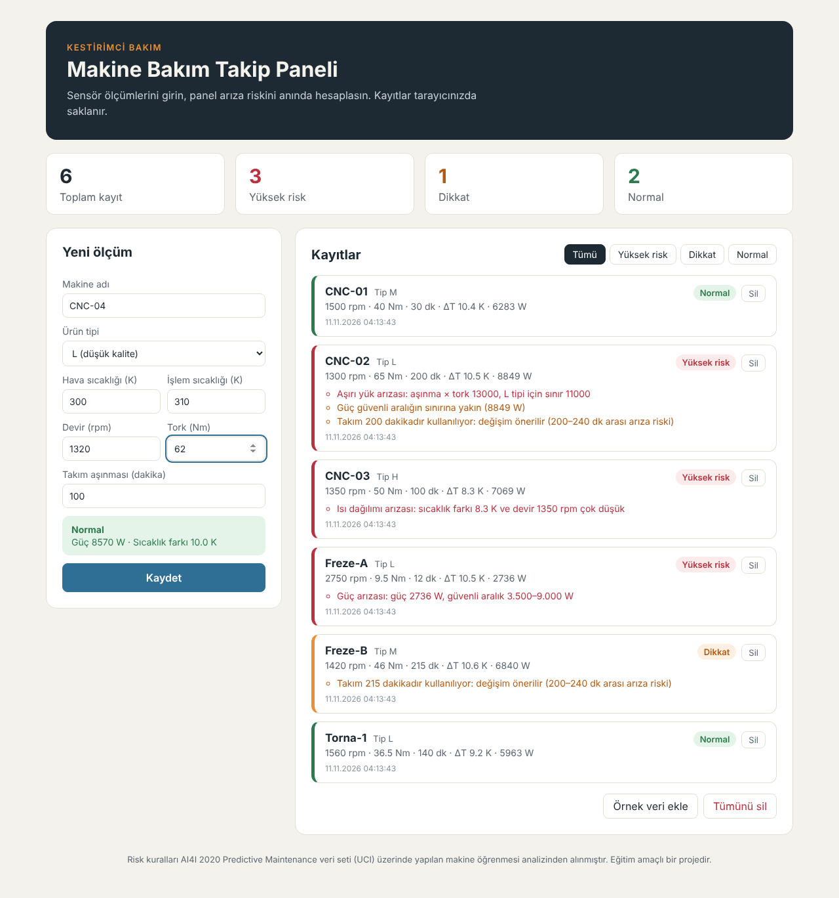

# Makine Bakım Takip Paneli

Fabrikadaki makinelerin sensör ölçümlerini kaydeden ve her ölçüm için arıza riskini anında hesaplayan bir web uygulaması. Software Persona & TNC Group Yapay Zeka Mesleki Gelişim Programı (31. dönem), Web Geliştirme; Yapay Zeka modülü projesidir.

**Canlı link:** https://bakim-panelinetlifyapp.netlify.app



## Ne yapıyor?

- Makine adı, ürün tipi (L/M/H), hava ve işlem sıcaklığı, devir, tork ve takım aşınması girilerek ölçüm kaydedilir.
- Form doldurulurken risk seviyesi canlı olarak gösterilir (Normal / Dikkat / Yüksek risk).
- Her kayıt için riskin nedeni yazılır: güç arızası, ısı dağılımı arızası, aşırı yük arızası veya takım değişimi önerisi.
- Üstteki kartlar toplam, yüksek riskli, dikkat gerektiren ve normal kayıt sayısını gösterir.
- Kayıtlar risk seviyesine göre filtrelenebilir, tek tek veya toplu silinebilir.
- Tüm veriler tarayıcının **LocalStorage**'ında saklanır; sayfa yenilense de kaybolmaz.
- "Örnek veri yükle" butonu ile uygulama hızlıca denenebilir.

## Risk kuralları nereden geliyor?

Bu proje, aynı programın Python ve Makine Öğrenmesi modüllerinde yaptığım kestirimci bakım çalışmasının devamı. AI4I 2020 Predictive Maintenance veri seti (UCI) üzerinde yaptığım analizde arızaları ayıran fiziksel koşulları buldum ve bunları `src/riskModel.js` içinde kural olarak uyguladım:

| Risk | Koşul |
|---|---|
| Güç arızası | Güç = tork × devir × 2π / 60; 3.500 W'ın altında veya 9.000 W'ın üstünde |
| Isı dağılımı arızası | İşlem − hava sıcaklığı 8,6 K'nin altında **ve** devir 1.380 rpm'in altında |
| Aşırı yük arızası | Takım aşınması × tork; L tipinde 11.000, M'de 12.000, H'de 13.000'in üstünde |
| Takım değişimi önerisi | Takım aşınması 200 dakika veya üstü |

Sınırlara %10'a kadar yaklaşan değerler "Dikkat" olarak işaretlenir.

## Kullanılan teknolojiler

- React 19 + Vite
- Saf CSS (kütüphane yok)
- LocalStorage
- Netlify (yayın)

## Kurulum

```bash
git clone <bu-deponun-adresi>
cd bakim-paneli
npm install
npm run dev        # geliştirme sunucusu: http://localhost:5173
npm run build      # yayın için dist/ klasörü
```

## Yapay zeka nasıl kullanıldı?

Geliştirme sürecinde yapay zeka asistanı olarak **Claude** kullanıldı.

- **Planlama:** Uygulamanın fikri, ekranları (özet kartları, form, kayıt listesi) ve veri modeli (makine, tip, 5 ölçüm, tarih) Claude ile birlikte planlandı.
- **Risk mantığı:** Makine öğrenmesi analizinde bulunan arıza koşulları, Claude ile birlikte JavaScript fonksiyonuna (`hesapla`) çevrildi ve veri setindeki arıza türleriyle karşılaştırılarak doğrulandı.
- **Bileşen üretimi:** Form, kayıt kartları ve filtre butonları Claude ile yazıldı; kod tarayıcıda çalıştırılarak kontrol edildi.
- **Stil:** Renk paleti ve mobil uyumlu düzen için öneri alındı.
- **Hata ayıklama ve test:** LocalStorage'ın sayfa yenilendikten sonra kayıtları koruması tarayıcıda test edildi.
- **Dokümantasyon:** Bu README'nin taslağı Claude ile hazırlandı.

Kullanılan örnek istem: *"React ile makine sensör ölçümlerini kaydeden bir form ve altında risk seviyesine göre renkli rozetli kayıt listesi yaz. Üstte toplam ve riskli kayıt sayılarını gösteren özet kartları olsun, veriler LocalStorage'da saklansın."*

## Not

Bu uygulama eğitim amaçlıdır. Kurallar sentetik bir veri setinden çıkarıldığı için gerçek bir fabrikada doğrudan kullanılmamalıdır.
